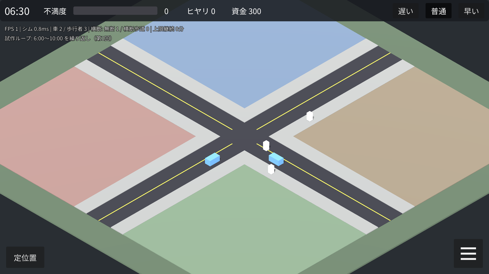
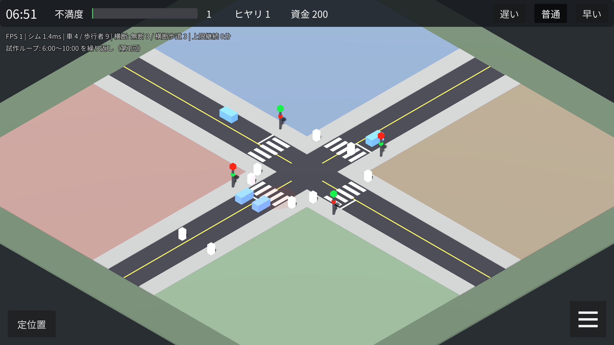

# トラック1 グレーボックス試作 — 報告書 v0.1

作成: 2026-11-24 / 実装: Claude Code / 対象: `docs/spec/claude-code-greybox-instructions.md`

試作で置いた数値はすべて **試作の初期値** です（確定値ではありません）。一覧と根拠は `game/scripts/core/tuning.gd` にまとめてあります。TBD の項目（タイトル、容量の上限、★のしきい値など）は確定させていません。




## 1. 遊び方（試作版）

- ゲーム内 6:00〜10:00 の朝ピークを繰り返します（通常速度で約50秒）。ループの終わりに、そのループの結果が画面左上に「前回ループ」として出ます。
- 右下の3本線ボタン → 設置パネル → 信号機 → 光っている交差点をタップ → 間隔を選んで「確定」。確定するとそのままプレイ画面に戻り、時間が進み始めます（「プレイに戻る」ボタンはなし）。確定前の「キャンセル」で場所選びに戻り、場所選びの途中の「やめる」で設置を中止してプレイに戻ります。
- 置いた信号をタップすると、間隔の変更と取り壊し（+50 返金）ができます。
- カメラ: 1本指ドラッグ = 移動 / 1本指で長押ししてからドラッグ = 回転 / 2本指 = ズーム / 「定位置」ボタン。マウスでは、左ドラッグ = 移動、右ドラッグ = 回転、ホイール = ズーム。
- 色: 車と歩行者は不満が高いほど赤くなります。赤い輪 = ヒヤリ（急ブレーキ）の発生地点。

## 2. 報告事項

### 2.1 信号プリセットの秒数（初期値）

| プリセット | 1方向あたりの青 | 黄 | 全赤 | 1周期 |
|---|---|---|---|---|
| 短い | 5秒 | 2秒 | 1.5秒 | 17秒 |
| 普通 | 8秒 | 2秒 | 1.5秒 | 23秒 |
| 長い | 12秒 | 2秒 | 1.5秒 | 31秒 |

- **単位は「通常速度での実時間の秒数」**です（Q1 で合意済み）。速度切替で一緒に伸び縮みします。ゲーム内時計の秒数ではありません。ゲーム内時計で数えると、ゲーム内1分が実時間で約0.2秒になり、信号が点滅にしか見えないためです。
- 決め方:
  - 50秒の朝ピークのループの中で、信号が数周期は回るようにしました。
  - 車1台が交差点を抜けるのに約0.5〜0.6秒かかるので、「普通」の青8秒で1車線あたり10台前後が抜けます。
  - 歩行者は、青が残り2.5秒未満なら渡り始めません。
- 結果: 3つのプリセットで不満度にはっきり差が出ました（下の 2.3 の表）。この地図では「短い」が最も良く、「長い」が最も悪い結果です。歩行者の信号待ちが不満の主な原因になっているためです。

### 2.2 横断歩道を使う迂回距離パラメータ（初期値）

- `PED_DETOUR_MAX = 6.0 マス`（1マス ≈ 3m なので約18m）
- 歩行者は「信号のある横断歩道を経由した道のり − 自分の進路上で無断横断した場合の道のり」が6マス以内なら、横断歩道を使います。
- 効き始める距離感:
  - 同じ道路の両側を行き来する人の場合、迂回距離は「2 ×（出入口が交差点から遠い方の、角からの距離 − 1）」になります。
  - したがって、出入口がだいたい交差点から4マス（約12m）以内なら横断歩道を使います。
- この1交差点の地図では、出入口が交差点の近くに偏るようにしているため、信号を置くとほぼ全員が横断歩道に寄ります（無断横断は1ループ平均78回 → 1.2回）。
- 「遠い人は使わない」というパズルの核心が本当に効くかは、交差点が4つあり、道路の途中にも信号を置けるステージ1で検証する必要があります。
- 信号を置いた瞬間に、まだ道路を渡り始めていない歩行者も経路を引き直します。そのため、「置いたら寄る」動きがすぐ見えます。

### 2.3 不満度ゲージの式

**個人不満 d（0〜100）。1シム秒あたりの増減:**

- **待ち**: 許容時間を超えて待っている間は加算します。待ちの種類で重みを変えています。
  - 車の切れ目を待つ歩行者（危険を伴う待ち）: 2秒を超えたら +6/秒
  - 赤信号で待つ歩行者（秩序ある待ち）: 4秒を超えたら +4/秒
  - 止まっている車: 2秒を超えたら +5/秒
- **遅延**: 移動時間が期待所要時間の1.25倍を超えたら +3/秒
  - 期待所要時間 = 理想経路の長さ ÷ 巡航速度
- **ヒヤリ**: 1回ごとに、歩行者 +15、車 +10、半径2マス以内で見た人 +6
- **伝染**: 近く（半径1.2マス）で待っている人たちの平均が自分より高ければ、その差 × 0.15/秒 だけ近づきます。
- **減衰**: 動いている間は −1/秒。目的地に着いた人はゲージの計算から外れます。

**街全体のゲージ:**

```
目標値 G* = Σ d ÷ max(街にいる人数, 25)
ゲージ G は G* へ指数的に近づく（G += (G* − G) × (1 − e^(−1.5 × dt))）
```

- 平均をベースにし、分母に下限 25 を設けています。人が少ない時間帯に、残った数人の不満だけでゲージが振り切れないようにするためです。
- 敗北条件のカウント（内部のみ）: ゲージ ≥ 99.5 がゲーム内2時間続くと「失敗条件に到達」。画面左上のデバッグ表示に出します。失敗画面は作っていません。

**調整結果（朝ピーク1ループ × 5つの乱数の種の平均。`game/tests/sim_test.gd` で再現できます）:**

| 条件 | 不満の最大（平均） | ヒヤリ／ループ | 無断横断／ループ | 横断歩道／ループ | 接触 |
|---|---|---|---|---|---|
| 信号なし | **88** | 19.2 | 78.2 | 0 | 0 |
| 信号あり・短い | 43 | 3.6 | 1.2 | 85.4 | 0 |
| 信号あり・普通 | **61** | 4.4 | 1.2 | 88.4 | 0 |
| 信号あり・長い | 77 | 5.6 | 1.2 | 87.6 | 0 |

目標「信号なしで上限近く／適切に置くと60前後」に対して、信号なし88、信号あり・普通61です。種による差は大きく、信号あり・普通は54〜74の幅があります。

### 2.4 FPS とファイルサイズ

| 項目 | 値 |
|---|---|
| `index.wasm`（エンジン本体） | 39.5MB（gzip 10.1MB） |
| `index.pck`（ゲームデータ） | 282KB（gzip 278KB）。中身のほぼすべては日本語フォント（使う文字だけに絞った Noto Sans CJK JP、279KB） |
| `index.js` | 280KB（gzip 68KB） |
| 初回読み込みの合計 | 約40MB（gzip 約10.4MB）。ほぼエンジン本体の分で、ゲーム固有のデータは約0.3MB |
| シムの処理時間 | 1ステップ約0.5ms（ネイティブ）。Web 版の実測では、エージェント約55体で1フレーム4.5ms（約7ステップ分）。60FPS の通常速度なら、シムは1フレーム1ms未満の見込み |
| **スマホブラウザの FPS** | **未計測**。GitHub Pages の公開後に、実機で画面左上の「FPS」を読んでもらう必要があります（4章） |

**スマホで確認してほしいこと**:
- 画面左上の FPS とシムの ms
- 1本指ですぐドラッグしたとき、回転ではなく移動になるか

後者について: 1秒に3フレームしか出ないソフトウェア描画の環境では、すぐ始めたドラッグが回転と判定されることがありました。入力の処理が遅れるためと見ていますが、実機では未確認です。

ヘッドレス Chromium（GPU なしのソフトウェア描画）では 1〜5 FPS でしたが、これは GPU のない環境での値で、スマホの性能を示すものではありません。描画とロジックのどちらが重いかを切り分けられるよう、画面左上に「FPS」と「シム ○ms」を並べて常に表示しています。

## 3. 受け入れ基準の自己チェック

| # | 基準 | 結果 |
|---|---|---|
| 1 | 信号なしで、歩行者が車を止めて渡り、渋滞と不満度の上昇が見える | ✅ 無断横断78回／ループ、ヒヤリ19回、不満の最大は平均88。車は止まった歩行者の手前で急ブレーキし、交差点で鉢合わせてためらい、列が伸びる |
| 2 | 信号を置くと、歩行者が横断歩道に寄る動きが見える | ✅ 置いた瞬間に経路を引き直し、横断歩道の前に集まって青で一斉に渡る（無断横断 78 → 1.2回） |
| 3 | 置けば下がり、置かなければ上がる、という因果が伝わる | ✅（数値上）。信号なし88 → 信号あり・普通61、ヒヤリは約4分の1に減る。ループの終わりに前回の結果が並ぶので比べやすい。ただし、プレイヤーに伝わるかは実際に遊んでもらって判断してほしい |
| 4 | ヒヤリ件数を数えられ、信号の有無で変化する | ✅ 上部バーに表示。19.2 → 4.4回／ループ |
| 5 | Web 書き出しでスマホブラウザで動き、FPS とサイズを報告できる | ⚠️ 書き出しとブラウザでの起動は確認済み、サイズは報告済み。**スマホ実機の FPS は GitHub Pages の公開待ち** |

**接触ゼロの保証**

- 全条件・全種の検証で、車と歩行者、車と車の接触は0回でした。
- 保証の仕組み: 歩行者は「止まりきれない車」がいる間は渡り始めません。車は、横断中の歩行者の通り道より手前で必ず止まります。位置も強制的に抑えるので、追い越しは起きません。
- 詰まったときの安全弁（3秒お互いに動けなければ歩行者を通す）も用意しましたが、検証では一度も発動していません（0回）。

## 4. 所感（面白さの芯が成立しているか）

- 「信号を置いた瞬間に、交差点の口で無断横断していた人たちが横断歩道に吸い寄せられ、赤い輪（ヒヤリ）が消える」変化は、画面ではっきり見えます。**芯の手応えはある**と判断しています。ただし、最終判断は実際に触ってもらってからにしてください。
- 間隔プリセットで結果が大きく変わる（43／61／77）ので、「置いて終わり」ではなく「調整する」余地も生まれています。

**ルール側の改善提案:**

1. **迂回距離パラメータは、1交差点ではほぼ効かない。** この地図では信号を置くとほぼ全員が横断歩道を使います。「遠い人は使わない」は、ステージ1（交差点4つと路上の信号）で改めて調整が必要です。
2. **信号待ちが歩行者の不満の主な原因になる。** 時間が圧縮されている（ゲーム内1時間 = 12.5秒）ので、1周期23秒でも「1時間半待たされた」感覚になります。秩序ある待ちの重みは軽めにしましたが、信号の周期と歩行速度の比は今後の調整点です。
3. **ゲージのピークは需要のピークより約1時間遅れる。** 移動中に不満がたまるためです。予報（例: 7〜9時）とゲージの山のずれを、プレイヤーが違和感なく受け取れるか確認が必要です。

## 5. 仕様への質問・確認したいこと

1. **信号なしの「譲り合わない」の表現**: 交差する車同士が鉢合わせると、0.8〜2.2秒ためらって時間を失う挙動を入れました。永久には詰まらず、ゆっくりは抜けます（Q2 の合意どおり）。この表現でよいですか。
2. **待ちの種類による重みの違い**: 「赤信号での待ち」を「車の切れ目待ち」より軽くしました。ゲームデザインとして採用してよいですか。
3. **ゲージの分母の下限（25人）**: 「平均ベース」の変形として入れました。この方式でよいですか。
4. **ヒヤリの数え方**: 車が歩行者のために急ブレーキした回数だけを数えています。車同士の急ブレーキは数えていません。これでよいですか。
5. **上部バーのヒヤリ件数**: 仕様 2.2 の上部バー（時計／ゲージ／資金／速度）にはありませんが、指示書の「画面に表示」に従って上部バーに置きました。本制作でどこに置くかは確認させてください。
6. **（食い違いの報告・対応済み）信号の秒数**: context ファイルは「信号プリセットの秒数は実装側で仮置きしない」、指示書は「初期値を決めて報告すること」と書いており、食い違っていました。優先順位どおり指示書に従い、初期値を置きました（2.1）。
7. **試作ループの自動繰り返し**: 10:00 で 6:00 に戻り、信号と資金は持ち越し、統計はリセットします。「前回ループ」の結果を左上に出しています。比較用の試作機能で、本制作の画面ではありません。

## 6. 公開（GitHub Pages）について

**現状**: ワークフローの初回実行では、ビルドは成功しました。公開（deploy）は「Pages が有効になっていない」（404）で失敗しています。下の設定をすれば、次の push か、Actions 画面からの手動実行（Run workflow）で公開されます。それまでは Actions が赤く表示されますが、想定どおりの状態です。


`.github/workflows/pages.yml` を追加しました。push すると、Godot の Web 書き出しをビルドして Pages に公開します。**次の設定はリポジトリ側でしかできないため、お願いします:**

1. Settings → Pages → Build and deployment → Source を **「GitHub Actions」** にする。
2. このリポジトリは **非公開（private）** です。非公開リポジトリで Pages を使うには、有料プラン（GitHub Pro / Team など）が必要です。無料プランの場合は、リポジトリを公開にする必要があります。
3. Pages の公開先（`github-pages` 環境）は、既定ではデフォルトブランチ（main）からのデプロイだけを許可する場合があります。作業ブランチから公開するなら、Settings → Environments → github-pages でブランチを許可してください。main にマージしてから公開する方法もあります。
4. 公開した URL は誰でも開けます。非公開リポジトリでもページ自体は公開されます。

## 7. 変更・追加したファイル

- `game/scripts/sim/` — 交通ロジック（`geometry.gd` 地図の形、`sim_world.gd` シミュレーション本体）。見た目に依存しません。
- `game/scripts/view/` — 表示（`world_view.gd` 箱と色、`camera_rig.gd` カメラ）
- `game/scripts/ui/hud.gd` — 上部バー、設置パネル、配置バー、ポップアップ
- `game/scripts/core/main.gd` — 状態遷移、時間の停止と速度、入力
- `game/scripts/core/tuning.gd` — **試作で置いた初期値の一覧**
- `game/tests/sim_test.gd` — ヘッドレス検証（`cd game && godot --headless --script res://tests/sim_test.gd`）
- `game/assets/fonts/` — UI 用の日本語フォント（使う文字だけに絞ったもの）とライセンス。UI の文言を変えたら `tools/make_font.sh` で作り直します。
- `tools/` — `setup_godot.sh`（導入）、`build_web.sh`（書き出し）、`make_font.sh`（フォント）
- `.github/workflows/pages.yml` — Pages への公開

## 付録: 試作で置いた初期値の一覧（`game/scripts/core/tuning.gd` と同じ内容）

すべて試作の初期値です。TBD の項目は確定していません。

| 区分 | 項目 | 初期値 |
|---|---|---|
| 時間 | 速度倍率（遅い／普通／早い）※TBD | 0.5 ／ 1.0 ／ 2.0（24時間 ≈ 10分／5分／2.5分） |
| 時間 | 試作ループ | ゲーム内 6:00〜10:00（通常速度で約50秒） |
| 時間 | シムの固定ステップ | 1/30 秒 |
| 地図 | 1マス | 1ワールド単位 ≈ 3m（片側1車線、両側に歩道各1マス） |
| 地図 | 道路の長さ（中心から） | 12マス |
| 地図 | 横断歩道の位置 | 中心から2.0〜3.0マス |
| 地図 | 停止線 | 中心から3.2マス |
| 地図 | 歩行者の出入口 | 歩道の角から1〜8マス（交差点寄りに偏らせる。偏り係数2） |
| 地図 | 車の出入口 | 中心から4.5〜9マス |
| 車 | 巡航／交差点内の速度 | 4.0 ／ 2.4 マス/秒 |
| 車 | 加速／通常の減速／急ブレーキの上限 | 4.0 ／ 4.0 ／ 9.0 マス/秒² |
| 車 | 車長／車幅 | 0.8 ／ 0.42 マス |
| 車 | 停止余裕（前の車／歩行者の横断線） | 0.75 ／ 0.6 マス |
| 車 | 信号なしで鉢合わせたときのためらい | 0.8〜2.2秒 |
| ヒヤリ | 判定の減速度 | 5.0 マス/秒² 超（歩行者のための急ブレーキ） |
| 歩行者 | 歩行速度 | 1.3 マス/秒 |
| 歩行者 | 横断歩道を使う迂回距離 | 6.0 マス以内 |
| 歩行者 | 渡り始めてよい青の残り | 2.5秒以上 |
| 信号 | 青（短い／普通／長い）※TBD | 5 ／ 8 ／ 12 秒 |
| 信号 | 黄／全赤 | 2.0 ／ 1.5 秒 |
| 信号 | 費用／資金／取り壊しの返金 | 100 ／ 300 ／ 50% |
| 発生 | 歩行者（基本＋ピーク） | 0.4 + 4.0 人/秒 |
| 発生 | 車（基本＋ピーク） | 0.3 + 3.0 台/秒 |
| 発生 | ピークの形 | 7.4時を中心とした山（幅0.6時間）。発生率 = 基本 + ピーク × exp(−((時刻 − 7.4) ÷ 0.6)²) |
| 不満 | 待ち（歩行者・車の切れ目） | 2秒を超えたら +6/秒 |
| 不満 | 待ち（歩行者・赤信号） | 4秒を超えたら +4/秒 |
| 不満 | 待ち（車） | 2秒を超えたら +5/秒 |
| 不満 | 遅延 | 期待所要時間 × 1.25 を超えたら +3/秒 |
| 不満 | ヒヤリ（歩行者／車／近くで見た人） | +15 ／ +10 ／ +6（半径2マス） |
| 不満 | 伝染 | 半径1.2マス、差 × 0.15/秒 |
| 不満 | 減衰 | 動いている間 −1/秒 |
| ゲージ | 分母の下限 | 25人 |
| ゲージ | 追従の速さ | 1.5/秒 |
| ゲージ | 上限の判定／敗北の猶予 | 99.5 以上／ゲーム内2時間（仕様で決定済み） |
| カメラ | 仰角／定位置の向き／定位置のズーム | 35.264° ／ 45° ／ 表示高さ16マス |
| カメラ | 回転速度 ※TBD | 0.35°/px（慣性なし） |
| カメラ | ズーム範囲 | 表示高さ6〜30マス |
| 操作 | 長押しの判定 | 0.35秒 |

## 追記（2026-11-24・スマホ実機での確認後）

- スマホ実機: **60 FPS／シム 2.3ms**（ユーザー報告）。受け入れ基準5の FPS は、この値で満たしたと判断できます。
- カメラ操作は「良い操作感」との評価でした。
- 変更: 確定したらそのままプレイに戻す（「プレイに戻る」を廃止）。ボタンと文字を約15〜30%大きくした（上部バー、速度ボタン、3本線ボタン、設置パネル、配置バー、ポップアップ）。

## 追記（2026-11-24・第1弾）

第1弾（安心の波・不満の理由・熱マップ・時間帯の光）を追加しました。詳細は `docs/roadmap.md`。

| 区分 | 項目 | 初期値 |
|---|---|---|
| 波 | 広がる速さ／最大の半径 | 14 マス/秒 ／ 14 マス |
| 波 | 通った人の不満を減らす割合（ルール追加。ユーザー決定） | 20% |
| 熱マップ | 冷める速さ／最も赤くなる値 | 25秒 ／ 8 |
| 24時間表示 | 夜（5時前・22時以降）の発生量／夕ピークの位置と比率 | 0.2倍 ／ 17.5時・朝の0.8倍 |

朝ピーク（6:00〜10:00）の結果は、第1弾の前後で変わっていません（同じ乱数の種で同じ値。信号なし88、普通61、接触0）。

## 追記（2026-11-24・第2弾）

- 波の効果を 20% に変更（ユーザー決定）。人をタップして理由を見る仕組みは廃止し、停止中は左上の不満の内訳だけを表示します。
- 暮らしの密度・仕草・雨と傘（見た目だけ）を追加。詳細は `docs/roadmap.md`。
- 確認用の URL: `?t=12`（開始時刻・24時間表示）、`&rain=1`（雨）。
- 朝ピークの結果は、変更の前後で変わっていません（信号なし88、普通61、接触0）。

## 追記（2026-11-24・第3弾）

ステージ1（交差点4つ）を追加しました（`?map=stage1`）。詳細と数値は `docs/roadmap.md`。

- 1交差点の地図は、そのまま残しています。回帰テスト（`game/tests/sim_test.gd`）の結果は、第3弾の前後で同じです（信号なし87.8、普通61.0、接触0）。
- ステージ1のテストは `game/tests/town_test.gd`（`-- --sweep` で、置く場所を全部試す。`-- --link` で連動の比較）と `game/tests/town_wave_test.gd`（連動の仕組みの確認）です。
- 追加した初期値は `tuning.gd` の末尾（`T_` で始まるもの）。
